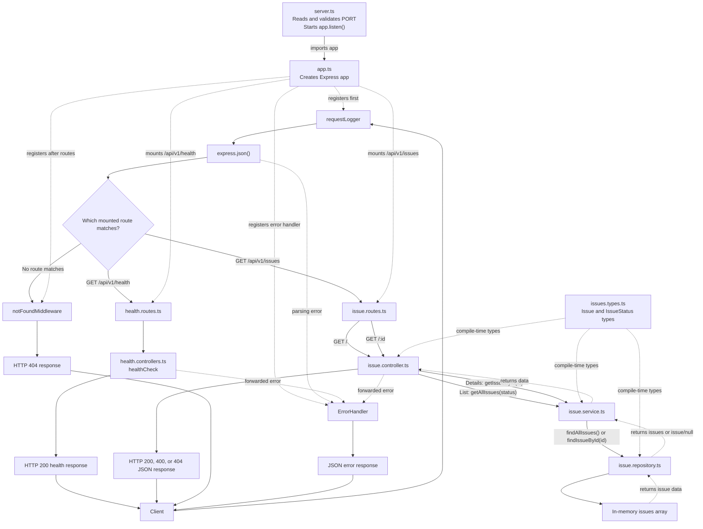

# ForgeBoard Backend Flow

This standalone preview shows how a request moves through the backend. Open it in GitHub or a Markdown preview with Mermaid support to render the diagram.

The health check responds directly from its controller. Issue requests go through the controller, service, and repository to the in-memory array. The array is temporary: its data is lost when the backend process restarts. The user router is not mounted yet.
